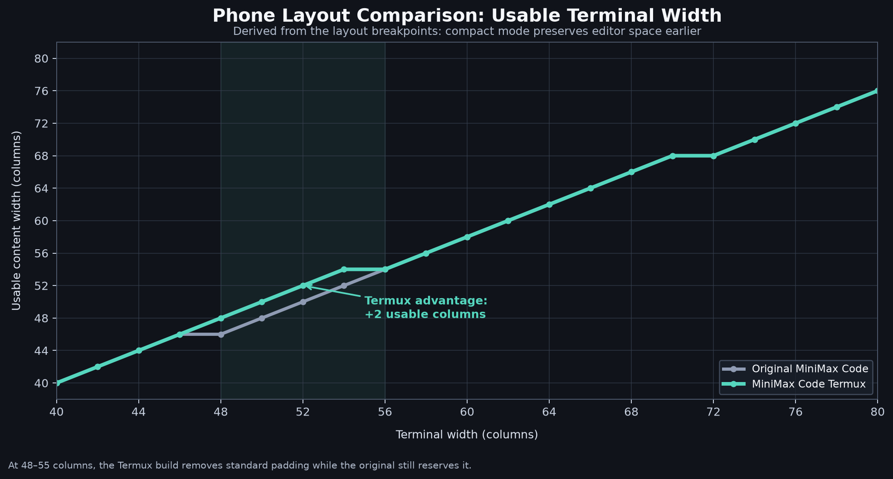

# MiniMax Code Termux
A phone-friendly build of **MiniMax Code**, the terminal coding agent for MiniMax, custom models, and development tools. This repository is tuned for Android users running **Termux**, mobile SSH clients, and narrow or short terminal windows.
> This is a terminal application, not a native Android APK. It runs on a phone through Termux or SSH.

```text
███╗   ███╗██╗███╗   ██╗██╗███╗   ███╗ █████╗ ██╗  ██╗
████╗ ████║██║████╗  ██║██║████╗ ████║██╔══██╗╚██╗██╔╝
██╔████╔██║██║██╔██╗ ██║██║██╔████╔██║███████║ ╚███╔╝
██║╚██╔╝██║██║██║╚██╗██║██║██║╚██╔╝██║██╔══██║ ██╔██╗
██║ ╚═╝ ██║██║██║ ╚████║██║██║ ╚═╝ ██║██║  ██║██╔╝ ██╗
╚═╝     ╚═╝╚═╝╚═╝  ╚═══╝╚═╝╚═╝     ╚═╝╚═╝  ╚═╝╚═╝  ╚═╝

                 C O D E   T E R M U X
             small screen · serious coding
```



The chart above compares usable content width across terminal sizes. The Termux build enters compact mode earlier, preserving more room for the editor on phone-sized terminals.

## Why this version exists

The upstream MiniMax Code interface is designed for desktop-sized terminals. This version keeps the upstream agent and command behavior while improving the terminal layout for mobile screens:

- Compact mode starts below **56 columns** instead of 48.
- Compact mode starts below **16 rows** instead of 12.
- The welcome screen considers both terminal width and available height.
- Narrow screens use less horizontal padding so the message editor keeps usable space.
- Regression tests cover common phone-sized widths and short viewports.

## Install on Android with Termux

Install Termux from [F-Droid](https://termux.dev/) or the official Termux source, then run:

```bash
pkg update
pkg upgrade
pkg install git nodejs-lts
npm install --global pnpm@9.12.0

git clone https://github.com/SoloFFCreator/minimax-code-termux.git
cd minimax-code-termux
pnpm install --frozen-lockfile
pnpm build
```

Start the interactive UI:

```bash
pnpm mcode
```

Start with a prompt:

```bash
pnpm mcode "Review this project and explain the safest next change"
```

Resume the latest session after reconnecting:

```bash
pnpm mcode --continue
```

## Configure an account or provider

Launch `pnpm mcode` and follow the managed MiniMax login flow. For a compatible custom provider, set the API key in the environment and add the provider:

```bash
export MCODE_PROVIDER_API_KEY="your-key"
pnpm mcode provider add \
  --name my-provider \
  --base-url https://example.com/v1 \
  --api-format openai-completions \
  --model my-model \
  --api-key-env MCODE_PROVIDER_API_KEY \
  --use
```

Never commit API keys to GitHub. Store secrets in your local Termux profile or a password manager.

## Phone usage tips

1. Use at least 48 columns when possible; rotate to landscape for long code and tool output.
2. Configure the terminal's extra-keys row for `Esc`, `Ctrl`, and arrow keys.
3. Use `Shift+Enter` for a newline when supported; the configured fallback is also available.
4. Keep the font large enough to read and avoid aggressive client-side line wrapping.
5. Use `pnpm mcode --continue` after an SSH or mobile terminal reconnect.

## Useful commands

| Task | Command |
|---|---|
| Start the UI | `pnpm mcode` |
| Continue the latest session | `pnpm mcode --continue` |
| Run one headless task | `pnpm mcode exec "your prompt"` |
| Show help | `pnpm mcode --help` |
| Install dependencies | `pnpm install --frozen-lockfile` |
| Build the project | `pnpm build` |
| Run the mobile layout test | `pnpm exec vitest run packages/tui/test/unit/tui/shell/layout-policy.test.ts` |
| Run typecheck | `pnpm typecheck` |

## Original versus phone-friendly build

| Area | Original MiniMax Code | This build |
|---|---|---|
| Main target | Desktop terminals | Termux, mobile SSH, and narrow terminals |
| Compact width | Below 48 columns | Below 56 columns |
| Compact height | Below 12 rows | Below 16 rows |
| Welcome sizing | Primarily width-based | Width and available height |
| Agent behavior | Upstream behavior | Unchanged |
| Native Android UI | Not included | Not included; use Termux or SSH |

Read the full [original-versus-mobile comparison](docs/ORIGINAL_VS_MOBILE.md) and the complete [Termux/mobile usage guide](docs/MOBILE_TERMUX.md).

## Validation

The deployed mobile layout has been verified with:

- Three focused layout policy tests.
- Standalone TypeScript typechecking.
- A production bundle build.
- Whitespace validation with `git diff --check`.

## Limitations

A terminal application cannot provide native Android widgets, push notifications, touch-specific controls, or independent background execution by itself. Those capabilities require a separate Android wrapper or mobile client. This project focuses on making the existing MiniMax Code terminal experience comfortable to use from a phone.

## License and upstream context

See [LICENSE](LICENSE), [CONTRIBUTING.md](CONTRIBUTING.md), and the upstream project documentation in `docs/`. This repository preserves the MiniMax Code runtime and extends its terminal layout for mobile use.
